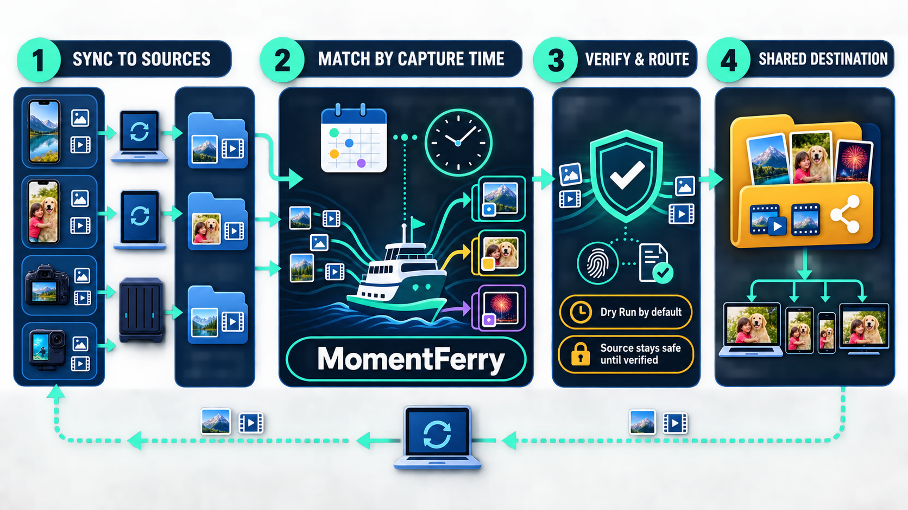
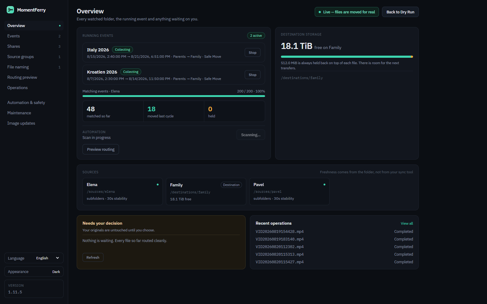
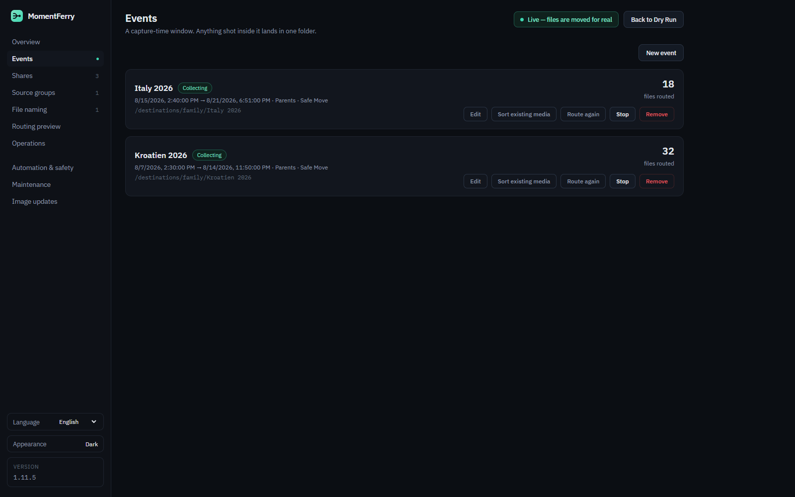
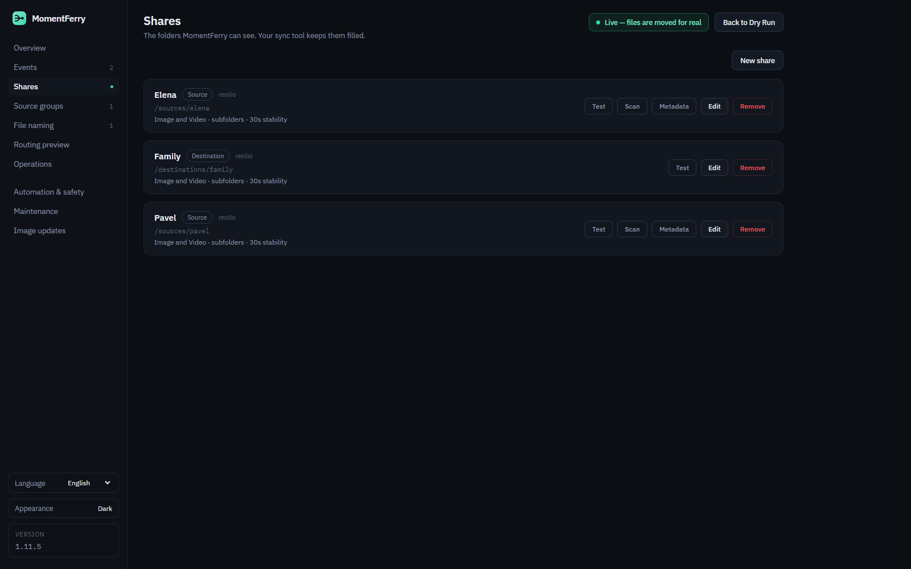
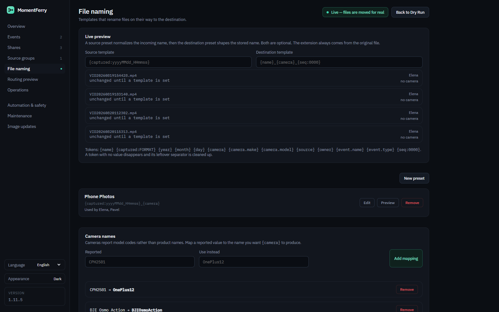
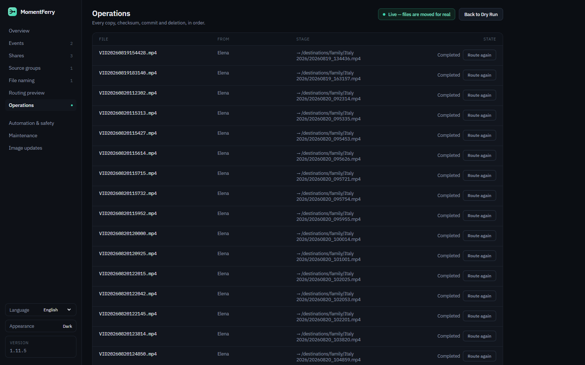
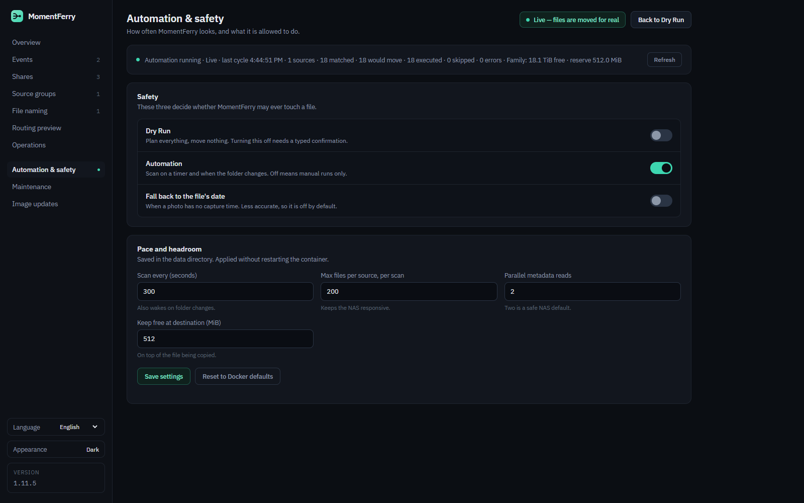
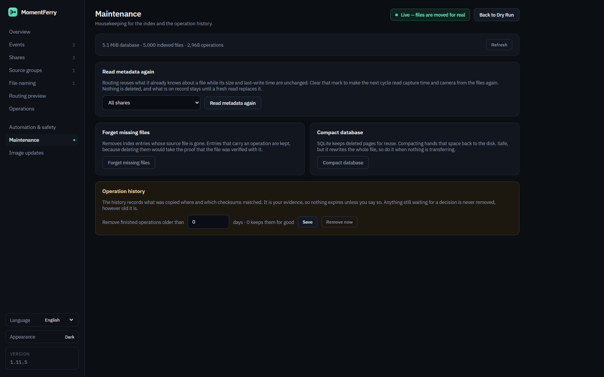

# MomentFerry

MomentFerry — safely bringing your moments together.

MomentFerry is a self-hosted media routing and collection service for synchronized folders.

It watches filesystem shares, identifies photos and videos from metadata, matches them to capture-time events, and safely routes them into shared destination folders. MomentFerry is deliberately sync-tool agnostic: Resilio Sync, Syncthing, Nextcloud clients, FolderSync, SMB uploaders, rsync, or another tool may synchronize the folders. MomentFerry only works with the resulting filesystem paths.

## How it works



## Screenshots

### Overview



### Events



### Share configuration



### File naming



### Operations



### Automation and safety



### Maintenance



## Primary use case

Several phones synchronize their camera folders to a NAS. During a vacation or another event, MomentFerry collects media captured inside the event window into a common destination folder. Existing sync software can then distribute that shared folder back to all participating phones.

Late synchronization is supported: a photo arriving after an event has ended is still matched using its capture timestamp.

## Safety model

The default destructive operation is **Safe Move**:

1. Wait until the source file is stable.
2. Read capture metadata with ExifTool.
3. Match exactly one event.
4. Persist the media file and operation state.
5. Hash the source, then ask whether the destination already holds that exact content — by hash, regardless of the name it was stored under. A match that is still verifiable on disk counts as an identical destination, and the event's duplicate policy decides whether the source is removed.
6. Check destination capacity before opening the staging copy.
7. Copy into a destination-side staging directory.
8. Verify the staged size, the staged SHA-256, and the source SHA-256 again — a source that changed while it was being copied is caught here.
9. Re-resolve the destination path, then commit the verified file.
10. Verify size and SHA-256 once more, in place, and set the committed file's timestamps to the capture time so galleries sort by shooting order. A filesystem that refuses the stamp never invalidates a verified copy.
11. Persist `DestinationCommitted` and `SourceFinalizePending`.
12. Delete the source only after the committed destination is verified.

If MomentFerry cannot prove the destination is safe, the source is preserved. Incomplete operations are reconciled after restart. Transfers for the same media file are serialized in-process to prevent concurrent duplicate execution.

A finished operation does not by itself stop a file from being routed again. Whether a file still has to move is decided by its bytes: if the destination already holds that exact content, under any name, the event's duplicate policy applies; if the copy is gone, the source is routed again.

Real filesystem copies keep a free-space reserve **in addition to the file being copied** — 512 MiB by default, adjustable under Automation & safety — whenever free capacity can be determined. If capacity cannot be determined, MomentFerry reports it as unknown rather than guessing.

**Dry Run is enabled by default**, and leaving it takes an explicit confirmation token that the REST API enforces as well, not only the Web UI. **Automation is enabled by default**, so a fresh container starts scanning immediately: Dry Run is what stands between it and moving files.

## What's new

- **2.2** — every process and error is logged; refused requests carry their reason and errors expand to the full stack trace in the Activity log. The routing preview runs as a background job with progress, so a reverse proxy no longer cuts it off with **504**.
- **2.1** — 12/24-hour clock and first day of the week under **Automation & safety**, a date picker that honours both, and a **Details** dialog in the Routing preview that explains why a file does or does not match an event.

Every change is listed in the [changelog](CHANGELOG.md).

## Features

**Routing**

- source and destination shares, source groups and capture-time events with start/stop
- image and video discovery with stable-file detection and per-share media extensions
- ExifTool metadata extraction with timezone-aware capture timestamps
- late-sync matching for closed events
- routing preview as a background job, filterable by name and result, with a per-file **Details** analysis against any event
- event backfill for media already on disk, and *Route again* for a single file or a whole event

**Safety**

- Safe Move and Copy, with SHA-256 verification before any source is released
- duplicate detection by content, including content the destination already holds under another name
- filename conflict handling and destination free-space reserve
- persistent operation state machine, restart recovery and explicit retry
- a *Needs your decision* queue for quarantined and retry-pending files
- Dry Run / Live mode gate, enforced by the API as well as the UI
- optional username/password protection

**Naming and storage**

- filename templates per share, camera-name mappings and a live preview
- re-applying the current naming rules to files an event already stored
- separate image/video destination subfolders
- destination files stamped with the capture time

**Operation**

- FileSystemWatcher wake-ups with periodic reconciliation
- automation and storage status, manual scans and a background-task tracker
- Activity log with expandable error details; request and process logging with an optional Debug level
- Maintenance: re-read metadata, forget missing files, compact the database, expire finished operations
- in-app image updates: check, one-click install and optional automatic installation
- Web UI in English, German, Russian, Polish, Italian, French and Ukrainian, with 12/24-hour clock and week-start settings

**Integration**

- REST API, OpenAPI JSON and a Swagger UI at `/docs`
- Prometheus metrics at `/metrics` and operation-history CSV export
- optional MQTT event control and Home Assistant examples
- Docker / Docker Compose image on GHCR

**Under the hood**

- .NET 10 / ASP.NET Core and SQLite with transactional, versioned schema migrations and a downgrade guard
- GitHub Actions build, tests and container validation

## Quick start

Copy `docker-compose.example.yml` and adapt the NAS paths:

```yaml
services:
  momentferry:
    image: ghcr.io/diddlik/momentferry:latest
    restart: unless-stopped
    ports:
      - "8080:8080"
    volumes:
      - ./data:/app/data
      - /path/to/phone1:/sources/phone1
      - /path/to/phone2:/sources/phone2
      - /path/to/shared:/destinations/family
```

Then start it:

```bash
docker compose up -d
```

Open `http://<server>:8080`.

### Optional access protection

Copy `.env.example` to `.env` beside the Compose file and set a strong, unique username and a password of at least 12 characters. `.env` is ignored by Git and must not be committed:

```dotenv
MOMENTFERRY_USERNAME=momentferry
MOMENTFERRY_PASSWORD=replace-with-a-long-random-password
```

Recreate the container so it receives the values, then enable **Require a username and password** under **Automation & safety**:

```bash
docker compose up -d --force-recreate momentferry
```

The credentials remain environment-only; the runtime settings persist just the enabled/disabled switch. When enabled, the Web UI, REST API, OpenAPI documentation and metrics require a signed-in session. `/health` and the login/status endpoints remain public so container healthchecks and login continue to work. Mutating API clients must send the session cookie plus `X-MomentFerry-Request: 1`.

Use HTTPS through a reverse proxy when exposing MomentFerry outside the trusted network. Authentication prevents unauthorised access, but plain HTTP does not encrypt the password or session cookie in transit.

The `data` volume contains the SQLite database, persistent runtime settings and the last completed automation status. Docker environment values act as initial defaults; settings saved in the Web UI are stored in `data/runtime-settings.json` and take precedence for runtime automation values.

The example file also carries the container healthcheck, the environment defaults matching the settings above, and a commented updater companion. That companion plus `MomentFerry__Updates__WatchtowerUrl` and `__WatchtowerToken` is what lets the in-app *Install update* button actually restart onto the new image; without it MomentFerry only reports that a newer release exists.

When adding a share, use the mounted-folder browser instead of entering a container path manually. Source shares are selected below `/sources`, destination shares below `/destinations`. Folders can be expanded to select any nested directory, so a single root mount can provide several independently configured shares.

## Recommended first setup

1. Keep **Dry Run** enabled.
2. Add each synchronized camera folder as a Source Share.
3. Add the common family folder as a Destination Share.
4. Create a Source Group containing the phone shares.
5. Create and start an Event.
6. Use Routing Preview and verify capture times and destination paths. **Details** on a file explains why it matches an event or not.
7. Check the destination storage status.
8. Only after testing, explicitly enable Live mode if Safe Move/Copy should run automatically.

## REST endpoints

Important endpoints include:

```text
GET  /health
GET  /metrics
GET  /api/v1/info
GET  /api/v1/status
GET  /api/v1/storage
GET  /api/v1/settings
PUT  /api/v1/settings
GET  /api/v1/folders?role=Source
GET  /api/v1/shares
POST /api/v1/shares/{id}/routing-preview
GET  /api/v1/routing-preview-jobs/{id}
GET  /api/v1/source-groups
GET  /api/v1/rename-presets
GET  /api/v1/camera-mappings
GET  /api/v1/events/
POST /api/v1/events/{id}/start
POST /api/v1/events/{id}/stop
POST /api/v1/events/quick-start
POST /api/v1/events/quick-stop
POST /api/v1/events/{id}/backfill
POST /api/v1/events/{id}/route-again
POST /api/v1/events/{id}/rename-routed
POST /api/v1/automation/run
GET  /api/v1/operations
GET  /api/v1/operations/export.csv
POST /api/v1/operations/{id}/retry
POST /api/v1/operations/{id}/route-again
GET  /api/v1/quarantine
GET  /api/v1/logs
GET  /api/v1/maintenance
GET  /api/v1/updates
POST /api/v1/updates/check
POST /api/v1/updates/install
POST /api/v1/recovery
```

The full contract is served as OpenAPI JSON at `/openapi/v1.json`, with a browsable UI at `/docs`.

## Logging

The **Activity log** on the Operations view shows the most recent 500 entries at Information and above: one line per scan, preview, transfer outcome, rename, maintenance action and changing API request, with the reason for every refusal and the full exception for every error. The container log carries the same lines. For per-file detail, such as each transfer stage, each rename decision and each file whose metadata could not be read, set:

```text
Logging__LogLevel__MomentFerry=Debug
```

Debug lines go to the container log only, so a large share cannot push everything else out of the Activity log. When the browser shows **504** behind a reverse proxy, the log says which request the client abandoned and how long it had run.

## MQTT

MQTT is optional and disabled by default. Configure it with `MomentFerry__Mqtt__*` environment variables. MomentFerry subscribes to:

```text
momentferry/events/command
```

and publishes responses/status to:

```text
momentferry/events/state
momentferry/status
```

Supported actions are `start`, `stop`, `quick-start`, and `quick-stop`. MQTT controls event windows only and never bypasses the Dry Run / Live transfer safety gate. See the Home Assistant example for payloads.

## Development

```bash
dotnet restore MomentFerry.sln
dotnet build MomentFerry.sln -c Release
dotnet test MomentFerry.sln -c Release
dotnet format MomentFerry.sln --verify-no-changes --no-restore
docker build -t momentferry:dev .
```

Add `-m:1` to the build and test commands on Windows: parallel project builds intermittently collide over file locks there.

CI validates the Release build, automated tests with coverage collection, and the Docker image. The runtime image contains ExifTool and a container healthcheck.

## Documentation

- [Implementation specification](docs/IMPLEMENTATION.md)
- [Architecture](docs/ARCHITECTURE.md)
- [Roadmap](docs/ROADMAP.md)
- [Database migrations](docs/DATABASE-MIGRATIONS.md)
- [Changelog](CHANGELOG.md)
- [Release process](docs/RELEASING.md)
- [Image updates](docs/UPDATES.md)
- [Backup and restore](docs/BACKUP-RESTORE.md)
- [Security policy](SECURITY.md)
- [Contributing](CONTRIBUTING.md)
- [Home Assistant example](examples/home-assistant/README.md)

## Status

Actively developed; the current release is listed on the [releases page](https://github.com/Diddlik/MomentFerry/releases). Remaining work is tracked in the [roadmap](docs/ROADMAP.md).
